# Connecting and sharing: a review

Written 13 and 14 October 2026, on 0.3.056, for the owner. A review and a proposal: no app code was changed.
The same review as a page, with the pictures and mockups: https://claude.ai/artifact/D94QDXwtojhEpwiQLW9ntr (private).

How it was looked at: the phone's and the PC's code were read; the PC's screens were drawn from the window itself with
made-up people and notes (`DesktopGalleryTest`, `DesktopPeopleBoxTest`, `DesktopSharedWithMeTest` and a new
`DesktopConnectGalleryTest`, which draws the steps that had no picture). The pictures used here are copied into
`docs/connect-review/`. **The phone's screens were not captured**: the emulator needs 4 GB and the laptop had 0.4 to
0.7 GB free during this review, and the owner's two phones were not touched. The phone's boxes below are therefore
described from its code, with its exact words, and drawn as mockups on the page version of this review.

Contents: 1. How it works now. 2. What gets in the way. 3. Proposal. 4. Questions for the owner. Appendix: what goes
between devices today, and the constraints a change must respect.

---

## 1. How it works now

### The one idea underneath

Every device has **a code**. A code is a line of text (`MN2.name|address|key|key`) drawn as a square picture, and the
same line as a link (`mininotes://pair/…`). Whoever **scans** a code learns the other device; their app then sends a
**hello** back, and the device that showed the code learns them too. Nothing is a secret in the code: what proves
nobody changed it on the way is six digits both devices can show.

A code can carry one more thing: **an offer** ("the note Groceries, Can write"). Scanning such a code both connects the
two devices and asks for the thing; the device that offered it gives it at once if its code was shown less than 15
minutes ago, and asks "Give it to them?" after that.

So there are really only two kinds of code, plain and offering, but the apps show **five**:

| Where | What it is called | What it really is |
|---|---|---|
| People and devices, + by People, *Show my code* | "My address" (phone), Profile's *Your code* (PC) | a plain code |
| A note's Share with, *Show them my code* | "Share Groceries", with Rights | a code offering that note |
| + by My devices, *Connect my other device…* | "Share everything" (phone), "Share 'all notes on this PC'" (PC), with Rights | a code offering everything, which also makes the scanner one of my devices |
| Profile, *Copy address* (both), *Address QR…* (PC) | the address | the bare Maxima address, with no keys: nothing can be sealed for it |
| Profile, *Share my link…* / *Copy my link* | a link with a few words | the plain code as a link |

And the camera that reads them has two names: *Scan their code* (People's +, Share with) and *From another device…*
(Home's +, every ⋮, Profile). The PC calls it *Scan a code or paste their link…* and *From another device*.

### Flow 1. Adding another person

**In person, phone to phone (People and devices first).**

| Step | Ana (shows) | Ben (scans) |
|---|---|---|
| 1 | ⋮ → *People and devices* | ⋮ → *People and devices* |
| 2 | + by *People* | + by *People* |
| 3 | *Show my code* → box "My address": "Hold this up to their phone, or send it to them. It is how anybody reaches this pad, both to send you things and to be sent them." Buttons *Change*, *Copy address*. Nothing says it is waiting. | *Scan their code* → camera, *Paste instead* (first time: the phone asks for the camera) |
| 4 | Nothing to press. When Ben's hello arrives, the strip says "Pairing with Ben…", then "Paired with Ben". Ana is never asked. | Paired **without a question**: strip "Saving Ana…", "Finding Ana on the network…", "Telling Ana you paired…", "Paired. Ana is asked to pair back". People and devices opens. |

Taps: 4 each, 8 in all, and nothing has been shared yet.

**At a distance.** Ana: + by People → *Share my link…* → the phone's share sheet, with "Connect with Ana on Mininotes,
the private notepad for the people close to you. Open this link on a device with Mininotes, or copy it and in
Mininotes tap + by People, then Paste their link: … No Mininotes yet? Get it here: …". Ben taps the link (many chat
apps do not make `mininotes://` clickable, so he often has to copy it), or copies it and uses + → *Paste their link*.
He sees "Pair with Ana?" with "Pasted, not scanned. To be sure nobody changed it on the way, open People and devices on
both phones afterwards: each shows six digits for the other, and they must be the same. Here: 739867." and one button,
*Pair*.

**On the PC** the + by People opens a menu (*Scan a code or paste their link…*, *Copy my link*, *Show my code…*).
*Show my code…* opens the whole **Profile** (name, colour, picture, Parlons! address) and the code is further down,
next to *Your Maxima address*, *Address QR…* and *Copy address*. A scan or a paste always asks "Pair with Ana?" (the
phone asks only for a paste). The PC cannot open a `mininotes://` link: it has to be copied and pasted, and the words
sent with the link tell a PC user to "tap + by People, then Paste their link", which the PC does not have. The pasted
box says "open People on both devices afterwards: each shows six digits", but the digits are only on each person's own
page. A phone added with the plain code from Profile is a person, never one of my devices, even when it is mine.
On both apps, the device that showed a plain code **pairs back without a question**.

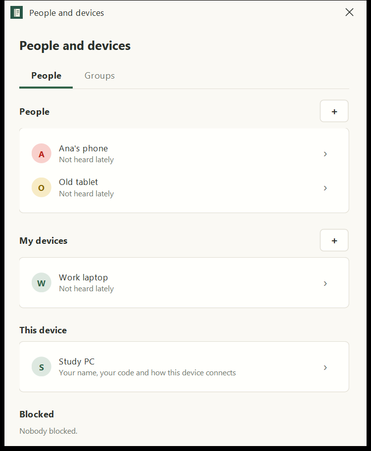
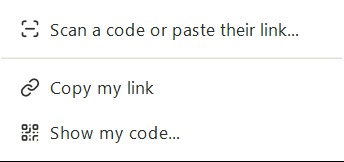
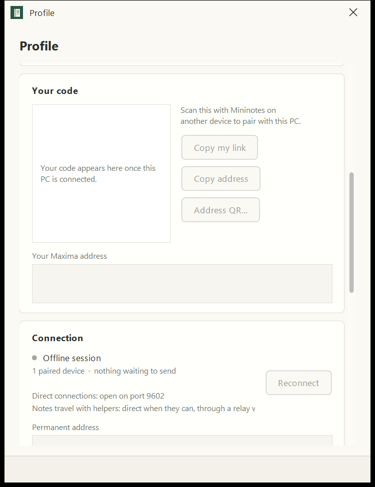
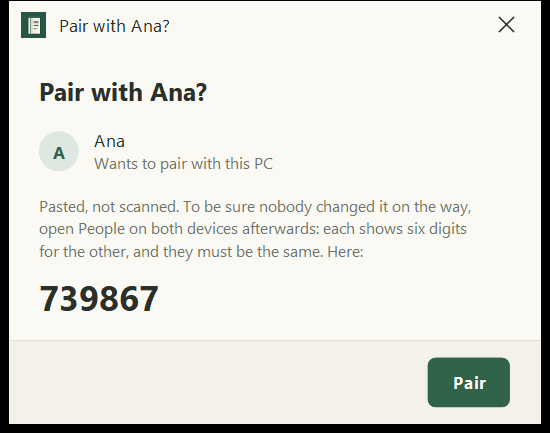
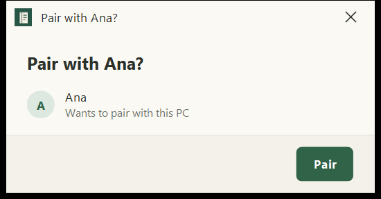
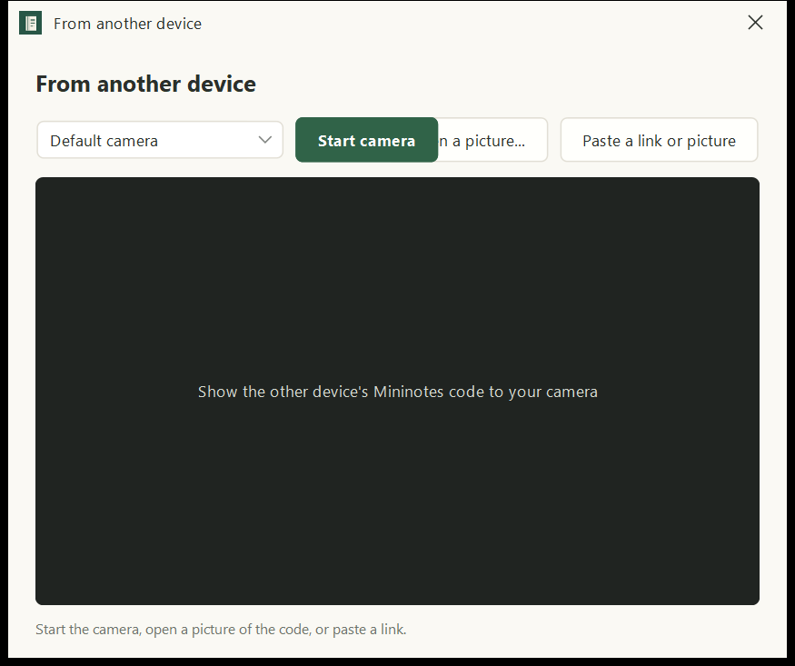

**When it fails.** (Corrected 14 October: the PC refuses a code that is not Mininotes'; the junk contact below is the
phone's only.) On the PC camera, "No webcam found. Connect one, or use Open QR image / Paste." is never shown (it is
caught and replaced by "Camera unavailable…") and names buttons that do not exist. The other device off or unreachable: the pairing is kept and the hello said again each time the app
opens ("Paired. Ana is told when it is next reachable"). On *Only between my devices*: "Ana is on another network",
with *Use helpers*. A picture that is not a Mininotes code (any QR code: a web address, a ticket) is **saved as a contact
called with its first eight letters and "Saved"**, a contact that can never receive anything.

### Flow 2. Adding one of my own devices

| Step | Old device | New device |
|---|---|---|
| 1 | ⋮ → *People and devices* | Install, open (no first-run step about other devices) |
| 2 | + by *My devices* (or Profile → *Connect my other device…*) | + on Home → *From another device…* |
| 3 | Box "Share everything" (phone) / "Share 'all notes on this PC'" (PC), **Rights: Admin, Can write, Can read**; the PC asks the role in a box of its own first, then *Show my code* | Scan → "Sam is sharing with you · everything on their pad · Can write: Can read it and change it. … It will appear on Home when it arrives." → *Accept* |
| 4 | Within 15 minutes, given at once; after that, "Ben accepted… Give it to them?" | Strip "Waiting for Sam to send it…", after 2 minutes "Not here yet. It comes when their phone is next open." |

Taps: 3 + 3. What makes the new device *mine* is only that the code offered everything; **nothing on the new device
says "this is your own device"**. The PC's box offers Admin, Can write and Can read for my own laptop. There is also
a *My device* switch on each device's page; turned on at one end only, it leaves a half state explained in a line on
that page.

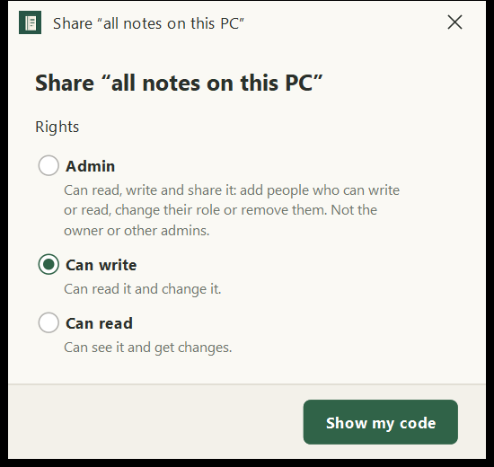
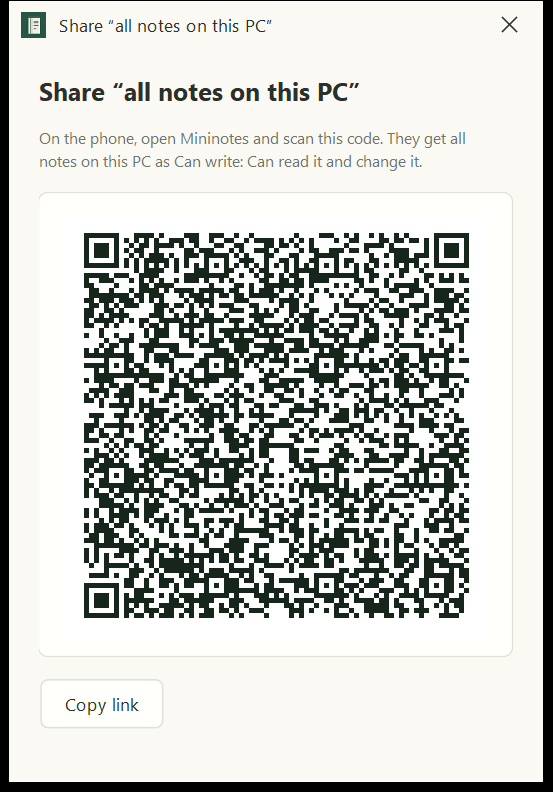
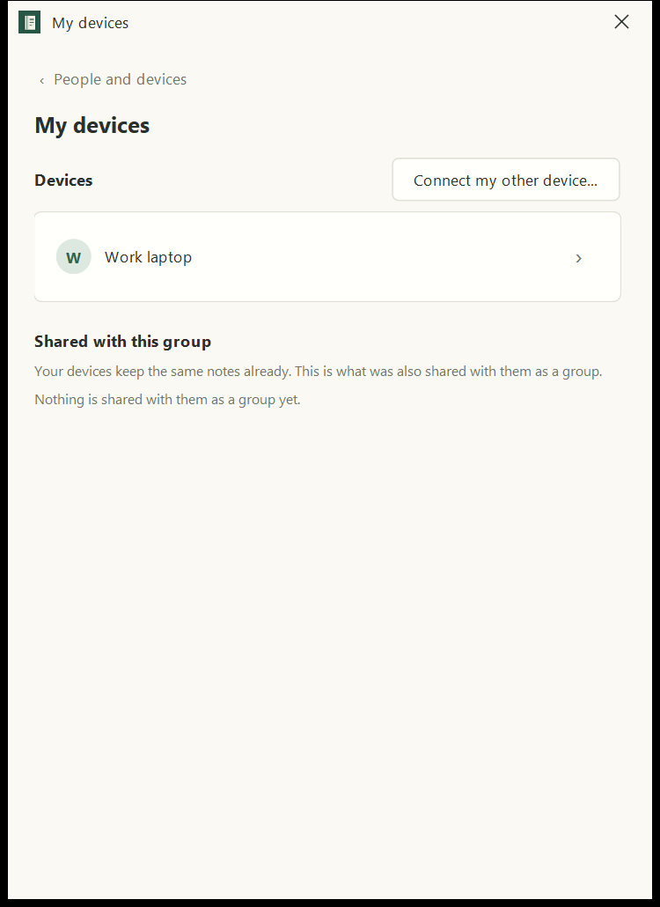

### Flow 3. Sharing a note, a folder or a file

**With somebody already connected, phone.** Note open: the + after the rounds (1) → "Share Groceries with" → *Add ▾*
beside Ben (2) → *Can write* (3) → Back (4). From Home: hold the icon (1) → *Share…* (2) → *Share* (3) → *Add ▾* (4) →
role (5) → Back, which reopens the Share box (6) → Back (7). The strip says "Sharing with Ben…", "Sending it to Ben…",
"Sent".

**With somebody new.** In "Share Groceries with", *Show them my code* opens the code offering Groceries, Rights first
(choosing one closes and redraws the box), "Waiting for them to scan it…", *Add someone* (which opens the camera) and
*Copy*. Ben scans with + → *From another device…* and sees "Ana is sharing with you · the note Groceries · Can write"
→ *Accept*. Ana's line turns to "Ben accepted. Sending it to them…". That path works well: 2 taps for Ana, 3 for Ben.

But *Scan their code* in the same box (when it is Ben who shows his code) **forgets the note** on the phone: the scan
only pairs, and Ana must go back to the note and share it again. The PC reopens "Share with" after pairing, so she can
pick Ben there.

**PC.** The Share box ("Who has access", *Add someone…*, *Show my code…*, "Syncing") and "Share Groceries with"
(Groups, People, *Scan a code or paste a link…*, *Show my code…*). *Show my code…* asks the role in its own box first,
then shows the code with "On the phone, open Mininotes and scan this code. They get Groceries as Can write: Can read
it and change it." and *Copy link*.

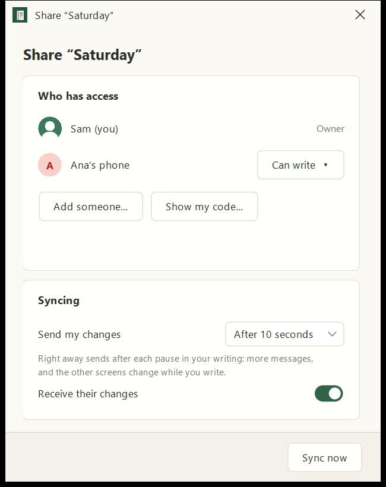
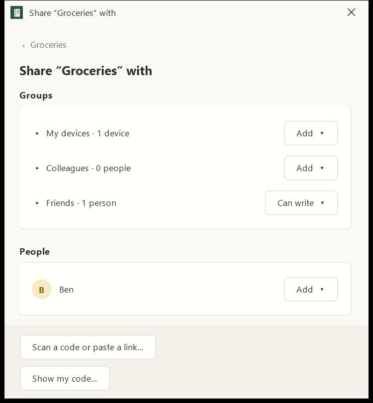
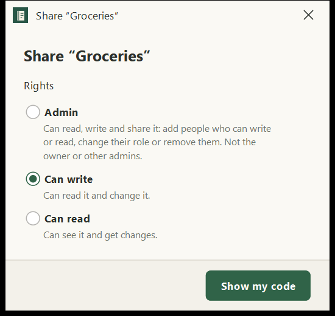
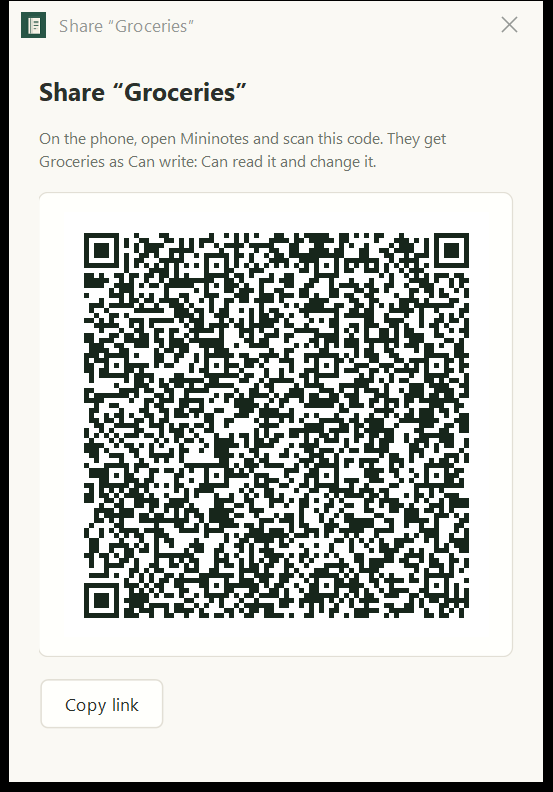

**The marks.** Six, the same on both apps: grey ring (only here), amber arrow (waiting to go), amber dots (sent, not
confirmed), green tick (everybody has it), grey bars (paused), red ! (not heard from for 3 days). There is no mark
for "waiting for them to accept" or "they refused".

### Flow 4. Receiving

Something shared with me for the first time by somebody else waits, hidden, in **Shared with me** (decision 109). A
pop-up "Shared with you · Ana shared "Saturday market" with you · A folder · Can write. It waits for you in Shared with
me." with *Later* and *See it*; when the app is away, a notification. In Shared with me it is an icon like any other
(decision 127); a tap offers *Accept*, *Refuse*, *See sender*. *Refuse* asks *Refuse quietly* or *Refuse and tell
them*, with a few words. *Block sender* is only offered for somebody not already in People and devices.

What a code I accepted brings does not wait: I said yes when I scanned.

Taps: *See it* → the icon → *Accept*: 3 on the phone, 2 on the PC (its Shared with me also has Accept and Refuse
under each waiting thing). The pop-up itself has no *Accept*.

**On the sender's side, today:** the receiver's device answers "I have it" as soon as the thing is kept, hidden or
not, so **Ana sees the green tick, "Up to date", while Ben has not accepted**. Accepting is not told to Ana. A refusal
told is said to Ana once, as a toast on the phone (gone in seconds) and a line in the Share box; if Ana cannot be
reached at that moment, she is never told. A quiet refusal leaves Ana's green tick for good.

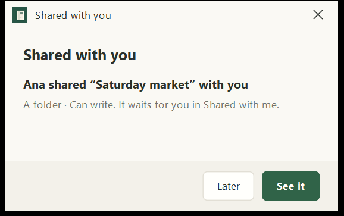
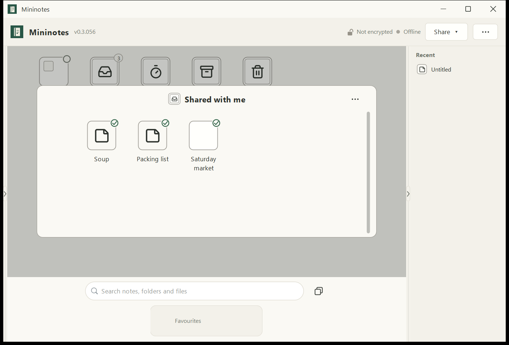
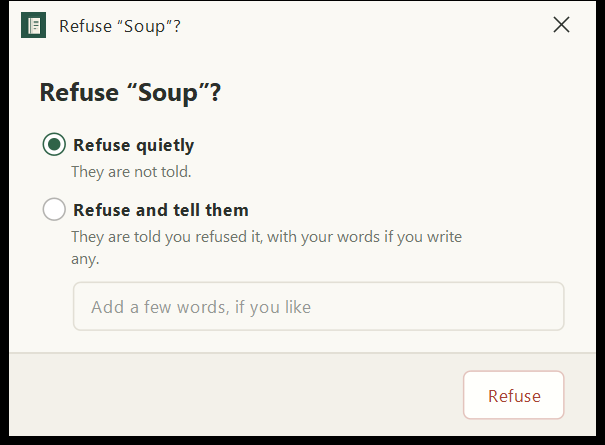

### Flow 5. What travels with a person

| What | Set where | Shown where | How it reaches others |
|---|---|---|---|
| My name | Profile, *Your name* | everywhere | in my code, in the hello, in each note's list of who has it. A rename after pairing does not seem to update the name on a contact's device (not proven) |
| The name I give them | their page, *Name*: "They share", "We call them", "Show" (theirs or mine), "On" (all my devices or this one) | everywhere | to my own devices only (a card), never to them |
| My picture | Profile, *Your picture* | every round | a card to everybody paired whose app takes it; nothing tells me who has it |
| A picture I give them | their page, *Picture…* | rounds here | never sent |
| My writing colour | Profile, *Your colour*, and Settings | rounds, and my writing in shared notes | rides with every note I send; so it reaches somebody only when a note does |
| A colour I give them | tap their round → *Writing colour…* | here | never sent |
| Show who wrote what | Settings switch | here | never sent |
| My Parlons! address | Profile | their page, *Chat on Parlons!* | a card to everybody paired whose app takes it |
| Their Parlons! address | their page, *Parlons!* | here | to my own devices, if I say so ("Where it goes") |
| Temp's people | Temp's menu, *Who it goes to…* | | as ordinary shares that end |
| Help request | Profile, *Help request…*; a note's menu | the receiver gets "HELP from …" | a card to the people chosen, only to builds that take it; one chosen on an older build gets nothing and the page does not say so. The PC's Profile card promises "Send your location"; the PC has none (its box says so) |

### Flow 6. People and devices, a person's page, Profile

**People and devices** has two views, *People* and *Groups*. People: *People* (+), *My devices* (+), *This device*
(Profile), *Blocked*. Each line is **a device**, named as that device calls itself ("Ana's phone", "Old tablet"): Ana
with a phone and a laptop is two lines. Under each: how it was last reached ("On this Wi-Fi · direct", "Through
relays", "Not heard lately"). Group chips under each person on the phone.

**A person's page** (both apps): their round, "Not heard lately", "Check with them: 991651", Parlons!, Picture, Files,
Address (*Show ›*: the raw address), then Name (four rows), Groups, what is shared with them, and *My device* /
*Forget*. *Forget* removes them from the list you pick from and **leaves everything shared with them shared**; it
shows the raw address. There is no "remove this person".

**Profile**: name, colour, picture, Parlons! address, this device's name, then the code with *Copy my link*, *Copy
address*, *Address QR…* (PC), *Your Maxima address*, then *Connection* with "Direct connections: open on port 9602",
"Notes travel with helpers: direct when they can, through a relay w…" (cut off on the PC), *Permanent address*.

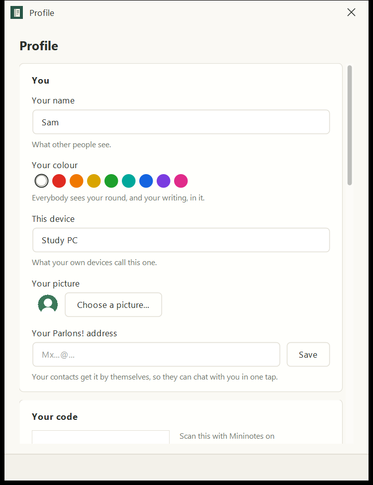
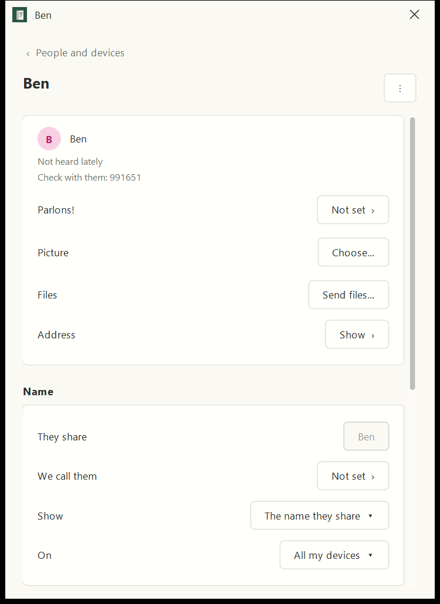
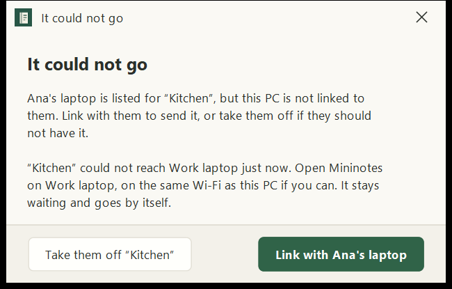

**Removing someone from a thing**: one tap, no question (a group asks first). **Groups**: *New group*, a page each,
*Add people ▾*, taking someone out asks.

### Words used for one idea

- Connecting: *Add someone*, *Add people*, *New person…*, *Connect with someone*, *Connect my other device…*,
  *Pair*, *Pair with it*, *Paired*, *Link with Ben's phone*, *Linked through "X"*, *From another device…*.
- The other side: person, people, contact, *Contact* (the name a bare address gets), device, *A paired device*,
  *Another device*, member, *Members*.
- The thing you show: code, *This device's code*, *My address*, *YOUR ADDRESS*, *Your Maxima address*, address,
  *Permanent address*, link, *pairing line*, *the line*.
- The thing you do with it: *Scan their code*, *Scan a code*, *Scan a code or paste their link…*, *Paste their link*,
  *Paste instead*, *Paste a link or picture*, *From another device…*, *Show my code*, *Show them my code*,
  *Share my link…*, *Copy my link*, *Copy link*, *Copy*, *Copy address*, *Address QR…*.
- Stopping: *Remove*, *Forget*, *Unfollow*, *Pause receiving*, *Refuse*, *Block sender*, *Take them off*.

### Technical things the user meets

Maxima address, Minima address ("That does not look like a Minima address or a pairing code"), Core ("Open Core and
copy the whole Maxima contact address", "Change my address: Paste this device's Maxima address, or scan it from
Core"), relay, helpers, *Only between my devices* (a code then works only on this Wi-Fi), port 9601/9602, door,
direct, permanent address, pairing line, six digits, "needs an update of Mininotes".

### Phone and PC, side by side

| | Phone | PC |
|---|---|---|
| Show my plain code | a box "My address" | the whole Profile, code further down |
| Scan a plain code | pairs without asking | asks "Pair with Ana?" |
| A code offering a note | "Ana is sharing with you", *Accept* | "Accept from Ana?", *Accept* |
| The role for a code | cards on the code box, each tap redraws it | a box of its own before the code |
| Copy, on the code | *Copy* (the line) | *Copy link* (the link) |
| Copy in Profile | *Copy address* (bare address) | *Copy my link*, *Copy address*, *Address QR…* |
| Scan from Share with | forgets the note | reopens Share with |
| The camera | straight to the camera, *Paste instead* | *Start camera*, *Open a picture…*, *Paste a link or picture* (the green button covers *Open a picture…*) |
| Accepted after 15 minutes | "Give it to them?" | "Ana scanned your code… Give access" |
| A `mininotes://` link | opens the app | cannot be opened; paste only |
| Sharing with a paired person | note's + round, 3 taps; from Home 7 | note's + round, 3 clicks; Share ▾ → Share… → Add someone… → Add ▾ → role, 5 |

---

## 2. What gets in the way

Most important first.

1. **Connecting and sharing are two separate jobs, and the app teaches the long one.** Its People page says "add
   someone" (8 taps across both phones), then the note must be shared (3 to 7 more), when one code that offers the note
   already does both in 5. Nothing leads a new user to the short path: the code that does both is behind *Show them my
   code* in a box they only reach after deciding to share. *Where:* People and devices, Share with, both apps. *Cost:*
   steps, and a first share that feels like two chores.

2. **Five codes and two cameras, with different names on each app.** Plain code, note code, everything code, bare
   address, link; *Scan their code* and *From another device…* for the same camera. The bare address (*Copy address*,
   *Address QR…*) cannot be used to pair at all, and pasting it makes a contact nothing can reach. *Cost:* the user
   cannot tell which code to show, and two of the five lead nowhere.

3. **The other side does not see what happens.** A plain code shown on the phone says nothing while it waits; the
   person who showed it is paired without being asked; the sender of a note gets a green tick before it is accepted,
   is never told it was accepted, and is told of a refusal once, in a toast. In Shared with me, what waits wears the
   same green tick as what was accepted. *Cost:* breaks "nothing goes on in silence", and a tick that lies.

4. **My own device is set up as "sharing everything" with a role.** The words are a share's (Share everything, Rights,
   Admin, Can write, Can read, "is sharing with you"); a role for my own laptop makes no sense; the new device is never
   told it is becoming mine; a fresh install does not offer it. *Cost:* the single most important set-up step for a new
   user with a phone and a PC asks a question they cannot answer.

5. **Technical words where a person connects.** Maxima address, Minima address, Core, permanent address, port, relay,
   helpers, pairing line, "Pasted, not scanned… six digits…" as a paragraph. Profile, the place *Show my code…* leads
   to on the PC, is full of them. *Cost:* the user meets the plumbing at the moment they should meet a person.

6. **People are devices.** Ana's phone and Ana's laptop are two people; a device's own name ("Old tablet") stands for a
   person; *Forget* leaves things shared. A name is set by four rows (They share, We call them, Show, On). *Cost:* lists
   grow wrong, and removing someone does not remove them.

7. **Bugs found on the way.**
   - Phone: *Scan their code* inside "Share X with" forgets X (`MainActivity.tookAddress` → `readPairing` gets no
     scope or target).
   - Phone: any QR code that is not a Mininotes code is saved as a contact that can never be reached
     (`tookAddress` keeps any 8+ letters with no space). The PC refuses it already.
   - Both: the receiver says "I have it" before checking whether the thing waits for acceptance (`Post`, around line
     4086), so the sender's green tick does not mean "they have it".
   - PC: on the camera box, *Start camera* covers *Open a picture…* (picture pc-07-scanner).
   - PC: Profile's "Notes travel with helpers: direct when they can, through a relay w" is cut off.
   - PC: "No webcam found…" is never shown, and names buttons that do not exist (`DesktopScanner`, lines 43 and 57).
   - PC: the pasted code's words send people to "People" for six digits that only a person's page shows.
   - Protocol: the help request and the hello share the same four letters (`MNH1`); a help request is told apart only
     because a hello cannot be read from its bytes. Worth a new mark before anything else is added.
   - Dead code: the phone's "Waiting for you" heading with Accept and Refuse (`Folder`, never given anything), the
     "Node settings" box, `confirmStop`.
   - From the code, not run: on the phone, choosing a note in the help request's page turns it on with no question
     (the private space asks; decision 113 says to ask). To check.

8. **Two ways to do one thing, and different on each app.** See the side by side table: the role asked in a box first
   on the PC and on the code on the phone; scan pairs silently on the phone, asks on the PC; Profile carries the code
   on the PC, a box does on the phone.

---

## 3. Proposal

The idea in one line: **one code per thing you want to happen, one camera called the same everywhere, and every step
said on both screens.** Nothing in the proposal needs a new kind of message for the main path: the offering code and
the hello that exist today already connect two people and hand over a note in one scan. What changes is which code is
put in front of people, the words, and three things said back to the sender.

### 3a. Adding someone and sharing a first note with them

**In person.** Ana wants Ben to have Groceries.

1. **Ana, on the note**: the share button on the note's head (the + after the rounds today, named **Share**). It opens
   one box, **"Share Groceries"**:
   - at the top, the people already connected, each with *Add ▾* (as Share with is today);
   - under them, **"Someone new"**: the code, already drawn, offering Groceries, with one line under it: **Can write ▾**
     (a drop-down, changed in place, the code redrawn under the finger, not the whole box);
   - under the code, quiet: *Send as a link…* and *Scan theirs instead*.
   - The one primary button: **Done**.
2. **Ben, anywhere in the app**: the + on Home → **Scan a code** (the same words in every menu and on both apps).
3. **Ben** sees **"Ana is sharing Groceries with you"**, Ana's round, "Can write: you can read it and change it", and
   one button, **Accept**. Under it, quiet: "Ana is added to your people."
4. Both screens say what happens: Ana's line under the code becomes "Ben accepted · sending…" then "Ben has it ✓";
   Ben's strip says "Waiting for Ana to send it…" then Groceries opens.

Taps: Ana 1 (plus showing the screen), Ben 3. **Removed:** People and devices as a first step; *Show them my code* as a
separate box; the Rights cards that redraw the box; the PC's role box before the code.

**At a distance.** Step 1 the same; Ana taps *Send as a link…*, the phone's share sheet (the PC copies it, saying
"Link copied: paste it in a message to Ben"). The words that go with it stay as today (decision 110), shorter. Ben
taps the link; the app opens on the same box as step 3. The six digits move from a paragraph to one quiet line, "Check
with Ana if you like: 739 867", and onto the person's page.

**Recommended change to the link: an https link.** Today the link is `mininotes://pair/…`, which many chat apps do not
make clickable. An `https://mininotes.org/c#…` link carries the same line after the `#`, which a browser never sends to
the website: a phone with Mininotes opens it straight in the app (an Android app link), and one without shows the
download page with "Then open this link again". The PC registers the same link. Old builds keep reading the line when
it is pasted, since it is the same line. *Alternative:* keep `mininotes://` and only shorten the words (no website
change). Recommendation: the https link, because "tap the link" is the whole of the distance path.

**Scan theirs instead** (when it is Ben who shows a code): Ana scans Ben's plain code from this box; it pairs **and
gives Groceries at the role chosen**, in one go (the fix for bug 7a; on the PC, without the extra trip back to Share
with).

**Adding someone without a note.** People and devices keeps its + by People, with the same box minus the note: "Add
someone", my plain code, *Send as a link…*, *Scan theirs instead*. One box, the same on both apps; the PC no longer
sends people into Profile for it.

**What it changes underneath.**
- No new message. The offering code, the hello, the 15 minute rule and "a code I took up does not wait" are kept.
- **Said back to the sender** (new, gated as every new thing is): a receipt "it waits for them to accept" (36), so the
  sender's mark becomes a fifth state, an **hourglass, "Waiting for Ben to accept"**, instead of the green tick; and
  the existing *Refused* answer sent again until answered, as everything else is. An older receiver says neither, and
  the sender keeps today's behaviour for it.
- The receiver's "I have it" for a waiting thing stays as it is (older senders rely on it); the hourglass is what
  replaces the tick on a sender that knows receipt 36.
- The "You were added by Ana" moment on the device that showed a plain code: still no question (showing the code was
  the asking), but said: "Ben added you" in the strip and, when away, a notification. See question 1.
- A scan of something that is not a Mininotes code: "That is not a Mininotes code" and nothing kept.
- **Stored data:** nothing changes for notes or contacts. One preference: the receipt 36 capability, as the others.
- **Older devices:** they can scan new codes and new devices can scan theirs (same line). An https link pasted into
  an old build is read, since `Pairing.line` already finds the line inside a link; to be checked with a test.
- **Size:** medium. Both apps' share boxes and the + menus (most of it), the receipt and the hourglass mark (small,
  both apps, tests), the https link (small in the apps, plus the website's page and its Android link file).

### 3b. Adding my own device

1. **New device, first start**: the welcome shows, once, under the paper: **"Already use Mininotes on another device?
   Scan its code"** (and it stays in the + as *Scan a code*).
2. **Old device**: People and devices → + by My devices, or Profile → **Add my device**. Box **"Add my device"**: "On
   your other device, open Mininotes and scan this." The code. No roles. Quiet: *Send as a link…*.
3. **New device** sees **"Join Sam's notes?"**: "This device becomes one of Sam's devices. All notes, people, groups and
   names come here and stay the same on both." One button, **Join**.
4. Both say what happens: "Adding Study PC…", "Study PC is one of your devices ✓", and on the new device a strip
   counting what arrives ("Receiving 120 notes…"), not silence.

Taps: 1 + 2. **Removed:** "Share everything", Rights for my own device, the *My device* switch from the main path
(kept on a device's page for repairs), the half state, and the 15 minute question (a device of mine is never asked
"Give it to them?": the code is the asking, for as long as the box is open, and an hour after).

**What it changes underneath.** Nothing on the wire: it is the same "everything" code (scope LIBRARY) and the same
bond. The role sent is fixed (as Admin, which the owner's own devices are treated as the owner anyway). The receiving
box reads the scope it already reads. **Stored data:** none. **Older devices:** an old device scanning a new "Add my
device" code sees today's "is sharing with you" box, which still works. **Size:** small to medium (both apps' boxes,
the first-start line, the arriving strip).

### 3c. Everything that travels with a person

**Mine: one card.** Profile opens on **"You, as others see you"**: your round with picture, your name, your colour, your
Parlons! address, all on one card, and under it one line that says where it has gone: "Sent to 4 people · 1 waiting
(Ben's phone, not heard lately)". Change any of the four and the card goes again, said in the strip. Below the card,
**This device's name**, then a fold **Connection details** for the address, ports, relays and permanent address (moved
out of sight, not removed).

**Theirs: one card, and my changes on it.** A person's page opens on their card as they made it. One button, **Change
for me…**: the name I call them (typed over theirs; cleared, theirs is back), a picture, a colour, their Parlons!
address if they did not set one. Under it, one quiet line: "Only you see these. Kept on all your devices" with *Only on
this device* as a choice inside. **Removed:** the "Show" row (a name I typed is the one I want shown) and the four rows
reduced to one field.

**A person, not a device** (the larger change, see question 3). Today Ana's phone and Ana's laptop are two people. A
contact's devices can be folded into one person when their apps tell each other which devices are one person's. Two
ways:
- **Recommended:** the new person card (below) also carries the person's id and a list of their devices' keys; a contact
  then shows **Ana**, with "2 devices" on her page, and sharing with Ana goes to both. Old devices keep seeing two
  lines.
- *Alternative:* no change on the wire; the user folds lines by hand ("Same person as…") on a device's page.

**What it changes underneath.** Today name, picture, colour and Parlons! address go by three different roads (the code
and hello, two cards, and inside every note). The proposal adds **one card, "about me"**, carrying the four together
with when each was decided, sent to everybody paired whose app says it takes it (receipt 38; 36 and 37 are now taken by the fix in section 5), on change and once to
anybody new. Older devices keep getting today's separate cards and the colour in notes, so nothing is lost for them.
It also fixes the rename that does not reach contacts today. **This changes what is sent between devices**, and, with
the recommended person folding, **what is sent to other people about my own devices** (how many I have). **Stored
data:** the existing columns are reused (`addresses.face`, `parlons`, `sharedName`, `said_inks`); folding people adds a
column for a contact's person id, an additive migration. **Size:** medium for the card and the two pages; medium to
large for folding devices into people (every list that shows a person).

### Words, everywhere, both apps

| Today | Proposed |
|---|---|
| Add someone, Connect with someone, Pair, New person… | **Add someone** |
| Connect my other device…, Add a device | **Add my device** |
| Scan their code, From another device…, Scan a code or paste their link… | **Scan a code** (paste on the camera, as now) |
| Show my code, Show them my code, My address, Your code | **My code** (in the boxes above) |
| Share my link…, Copy my link, Copy link, Copy | **Send as a link…** (phone) / **Copy link** (PC) |
| Copy address, Address QR…, Your Maxima address, Permanent address | moved to *Connection details* |
| contact, device, member, A paired device | **person** for people, **device** only for my own |
| Forget | **Remove Ana**: takes her off everything I shared and from my people (with a question) |
| Pair with it, Link with Ben's phone | **Add Ben** |

### What is not proposed

The four roles, groups, Shared with me, accept and refuse, the marks (one added), the merge, the sealing, the outbox
and the six digits all stay. The relay choice stays in Settings.

---

## 4. Questions only the owner can answer

1. **Anybody with my link can add me, without my saying yes** (as today, but said in the strip). Keep that, or ask
   "Ben wants to add you" each time? (Recommendation: keep it; what they share still waits for my Accept.)
2. **The https link through mininotes.org**, carrying the code after the `#` (never sent to the site)? Or keep
   `mininotes://`?
3. **One person, several devices**: may my app tell my contacts which devices are mine, so they see "Sam" once and not
   "Sam's phone" and "Study PC"?
4. **My own device always gets everything, with full rights**: any case for a device of mine that only reads?
5. **The word**: "Add someone" and "Add my device", with "pair", "connect" and "link" gone from the screens?
6. **Remove a person** (off everything I shared with them, out of my people, they are told): wanted, beside today's
   *Forget*?
7. **Order of work**: the three bugs first (scan in Share with, junk contacts, the early green tick), then 3a, 3b, 3c?

---

## 5. The owner's answers, 14 October 2026, and what they change

1. **Connecting is an invitation, accepted or ignored, as a shared thing is.** Today the device that showed a code pairs
   back by itself. It will not: "Ben wants to connect" waits, with *Accept* and *Ignore*, beside what waits in Shared
   with me, and Ben's side says "Waiting for Ana to accept" until she does. In person, where Ana is holding up the code,
   it is one tap on her own code box ("Ben scanned it · Accept"). Ignore tells nobody. On the wire: the hello that
   arrives is kept, not answered, until Accept (an old device that scans gets no answer until then, which it already
   copes with: it says the hello again at each opening). A code that offers a thing stays one step for the person
   scanning: their Accept is the answer to Ana's invitation, and the thing still comes.
2. **`mininotes://` stays; no website.** The https link alternative is dropped. The words sent with the link stay short
   and say to paste it in *Add someone* where the link is not clickable; the PC learns to open `mininotes://` links.
3. **Yes: one person, several devices.** The "about me" card also carries the person's id and their devices' keys, so a
   contact sees one Ana with two devices.
4. **A device of mine may only read.** *Add my device* keeps one choice: *Can write ▾* (the default) or *Can read*.
5. **"Add someone" and "Add my device"**, everywhere, both apps; pair, connect and link go from the screens.
6. **Remove this person**: off everything I shared with them, out of my people, and they are told; with a question.
7. **The three bugs first. Done (unversioned, both apps, tests pass, not installed):**
   - A code scanned from Share with on the phone comes back to Share with once paired, the thing not forgotten.
   - A picture of anything but a Mininotes code is refused on the phone: "That is not a Mininotes code. Nothing was kept."
   - The sender is told what waits: two new answers, "it waits for me to accept it" (36) and "I accepted it" (37), said
     only to devices heard answering, and again until they go. The sender draws Sent (not the green tick), "Sent ·
     waiting for them to accept" in the Share box, "Waiting for Ben to accept it." on Ben's round, and "waiting for the
     others" under the note. Older devices neither say nor hear them. Nothing changes in the notebook (it is kept in the
     settings, as locked devices are). HOME.md, decision 163.

## Appendix A. What goes between devices today

| Mark | What | From → to | When |
|---|---|---|---|
| `MN2.` line | the code: name, address, two keys, an offer, a role, what is offered | shown, scanned, pasted, linked as `mininotes://pair/…` | by hand |
| `MNH1` hello | name, address, keys, role, what was accepted; a person tail between own devices | scanner → shower, and back | on scan; said again at each opening until answered (up to 60 times) |
| `MNB1` parcel | a note, its path, who has it, the writer's colour, Temp's end | → everybody it is shared with | on change |
| `MNC1` carton, `MNF1` sleeve | a folder, a file shared on its own | → builds that say they take them | on change |
| `MNR1` receipts 1 to 35 | I have it, send me, left, removed, refused, and "this build takes …" | any → paired | as they happen |
| `MNA1`, `MNG1`, `MNN1` | persons, groups, names I give | own devices only | on change |
| `MNY1`, `MNP1` | my picture, my Parlons! address | everybody paired that takes them | on change |
| `MNH1` help card | place, words | the chosen people | when the note opens, then every 5 minutes for an hour |

## Appendix B. Constraints a change must respect

- The address in a code goes stale; the keys do not. A link that lasts for ever needs a directory or a key-only
  address (DIRECT.md phase 3, not built).
- Nothing completes until both devices have been reachable at some moment; the hello is pushed and retried.
- Only the hello is taken from somebody unknown; anything new for strangers must ride on it or be gated the same way.
- An older build writes unknown bytes as a note: nothing new is sent to a device until it has said it takes it (a new
  receipt number, 36 and up).
- Keep `MN2.`, its 4/6/8 fields, `mininotes://pair/` (read), the role encoding, the hello's order and tail, and
  `mininotes.v1`.
- A device is its signing key. Person ids never leave my own devices today; showing people as people to others is a new
  gated card.
- Migrations only add.
- Only an answer from the far device counts as delivered; a new mark must not claim more.
